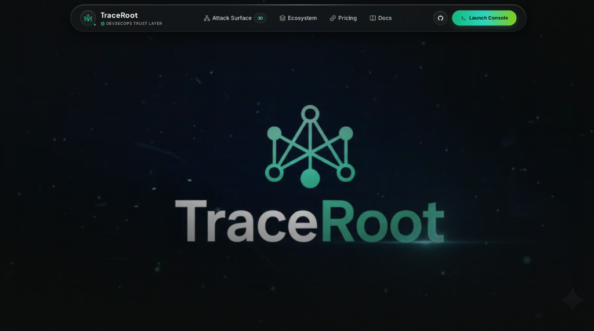
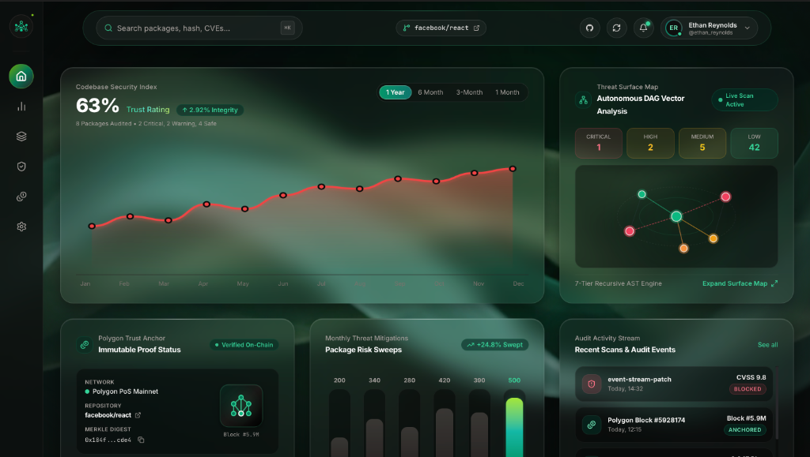
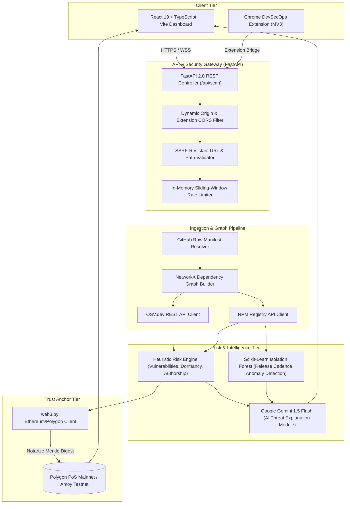

<div align="center">

# 🌲 TraceRoot
### **Autonomous DevSecOps Trust Layer & Supply Chain Integrity Scanner**

[](https://fastapi.tiangolo.com)
[](https://react.dev)
[](https://www.typescriptlang.org)
[](https://tailwindcss.com)
[](https://ai.google.dev)
[](https://scikit-learn.org)
[](https://polygon.technology)
[](https://opensource.org/licenses/MIT)

<br />

<p align="center">
  
</p>

*Traces the hidden roots of your dependency tree with 7-Tier Recursive AST Analysis, Machine Learning Anomaly Detection, Generative AI Threat Intelligence, and Immutable Blockchain Trust Anchoring.*

</div>

---

## 📸 Interface Preview

<div align="center">
  
  <p><em>TraceRoot Autonomous Attack Surface Console: Live Codebase Security Index, DAG Vector Map, and On-Chain Polygon Anchoring.</em></p>
</div>

---

## 📌 Problem and Solution Overview

### The Problem
Modern web and software ecosystems rely heavily on sprawling open-source dependency trees. A simple package install can quietly drag in hundreds of transitive sub-dependencies across deeply nested Directed Acyclic Graphs (DAGs). This creates severe supply-chain vulnerabilities:
- **Transitive Attack Vectors**: Attackers target low-profile, deeply nested packages (via account takeovers, malicious PRs, typosquatting, and maintainer abandonments) rather than primary libraries (e.g., the infamous `event-stream` incident).
- **Lagging Static CVEs**: Traditional vulnerability scanners only flag known CVEs that have already been disclosed and categorized in databases. They fail to detect zero-day anomalies, sudden release-cadence spikes, dormancy rebounds, or suspect package behavior before disclosure.
- **Audit Tampering & Lack of Verification**: Security reports generated during CI/CD can be altered, intercepted, or disputed. There is no decentralized, immutable proof verifying the integrity of an audited dependency state at a specific point in time.
- **Security Alert Fatigue**: Developers are bombarded with raw CVSS numbers and cryptic vulnerability strings without contextual, human-readable security analysis.

### The Solution: TraceRoot
**TraceRoot** provides an end-to-end **DevSecOps Trust Layer** that audits, scores, explains, and notarizes software dependencies:
1. **Multi-Tier Dependency Graph Construction**: Traverses and maps both direct and transitive package dependencies using NetworkX, computing recursive topological depth and centrality metrics.
2. **Aggregated Threat Intelligence**: Queries real-time vulnerability data from the Open Source Vulnerabilities (**OSV.dev**) database and maintainer release metadata directly from the **NPM Registry**.
3. **Behavioral Anomaly Detection (ML)**: Runs an unsupervised **Isolation Forest** model to detect irregular package release patterns, anomalous dormancy gaps, and sudden distribution anomalies.
4. **Autonomous AI Threat Briefings**: Deploys **Google Gemini AI** to transform raw CVSS scores and heuristic indicators into concise, developer-friendly 2-sentence threat explanations.
5. **Immutable Polygon Blockchain Anchoring**: Generates a cryptographic Merkle root of the dependency manifest and notarizes the audit on the **Polygon PoS** blockchain for tamper-proof compliance.
6. **Next-Gen Cyberpunk Glassmorphic Console & Browser Extension**: Delivers real-time 3D attack surface maps, security ratings, and instant repository scanning via web or companion Chrome extension.

---

## 🏛 Architecture

### System Architecture Diagram



### Component Breakdown
- **Frontend Console (`/frontend`)**: Built with React 19, Vite, Tailwind CSS, and Framer Motion. Renders glassmorphic bento cards, dynamic threat vectors, real-time code index graphs, and dependency inspection drawers.
- **Backend Core (`/backend`)**: FastAPI server powering asynchronous package resolution, graph traversal, and multi-threaded threat enrichment.
- **DevSecOps Extension (`/devsecops-extension`)**: Chrome Manifest V3 extension injecting repository health audits directly into GitHub UI.
- **Anomaly Detection Service (`backend/app/ml`)**: Unsupervised anomaly detection trained on release cadence metadata (`days_since_previous_release`, `release_gap_ratio`, `package_age_days`, `release_frequency_90d`).
- **AI Explanation Engine (`backend/app/ai`)**: Gemini-powered prompt engineering generating strict, authoritative threat summaries.
- **Blockchain Notarization (`backend/blockchain.py`)**: Smart contract / transaction wrapper committing SHA-256 Merkle root hashes of dependency manifests to Polygon.

---

## 🤖 AI & ML Model Details

TraceRoot leverages a dual-tier artificial intelligence pipeline: **Machine Learning** for numerical behavioral anomaly detection, and **Generative AI** for actionable security summarization.

### 1. Generative AI Model (Threat Intelligence Explanations)

| Attribute | Specification |
|:---|:---|
| **Model Name** | **Gemini** |
| **Model Version** | `gemini-1.5-flash` *(Configurable to `gemini-1.5-pro`)* |
| **Model Source** | **Google DeepMind / Google AI** |
| **Access Method** | Official `google-genai` Python SDK via Google AI Studio API (`GEMINI_API_KEY`) |
| **Applicable Model License / Terms** | [Google AI Studio Terms of Service](https://ai.google.dev/terms) & [Google Cloud Platform Terms of Service](https://cloud.google.com/terms) |
| **Role of the Model in the Project** | **Automated DevSecOps Threat Analyst**: Evaluates packages with high risk scores ($\ge 70/100$) and complex combinations of CVSS scores, maintenance red flags, and dormancy spikes. It synthesizes these inputs into a concise, 2-sentence developer explanation detailing the exact attack vector and potential damage without hallucination. |

### 2. Machine Learning Model (Behavioral Anomaly Detection)

| Attribute | Specification |
|:---|:---|
| **Model Name** | **Isolation Forest Package Anomaly Detector** |
| **Model Version** | `sklearn.ensemble.IsolationForest` (Baseline serialized model: `baseline_model.joblib`) |
| **Model Source** | Scikit-Learn Open Source Library + Custom NPM Release Telemetry Baseline (`traceroot_real_features.csv`) |
| **Access Method** | Local Python runtime execution via `scikit-learn` and `joblib` |
| **Applicable Model License / Terms** | [BSD 3-Clause License](https://github.com/scikit-learn/scikit-learn/blob/main/COPYING) |
| **Role of the Model in the Project** | **Release Pattern Outlier Detection**: Ingests numerical features (`days_since_previous_release`, `release_gap_ratio`, `package_age_days`, and `release_frequency_90d`) to identify suspicious release rhythms (e.g. dormant packages suddenly releasing updates after years). Computes an anomaly score ($0\text{--}100$) integrated into the composite risk assessment without overriding confirmed OSV vulnerabilities. |

---

## 📦 Dependencies

### Backend Dependencies (`backend/requirements.txt`)

| Package | Version | Purpose |
|:---|:---|:---|
| `fastapi` | `>=0.104.0` | High-performance asynchronous API framework |
| `uvicorn` | `>=0.24.0` | ASGI web server implementation |
| `google-genai` | `>=1.0.0` | Official Google GenAI SDK for Gemini 1.5 threat explanations |
| `scikit-learn` | `>=1.3.0` | Machine learning library for Isolation Forest anomaly detection |
| `joblib` | `>=1.3.0` | Model serialization and persistent pipeline caching |
| `networkx` | `>=3.2` | Directed Acyclic Graph (DAG) construction and network metrics |
| `web3` | `>=6.11.1` | Ethereum / Polygon EVM interaction for audit anchoring |
| `httpx` | `>=0.25.0` | Asynchronous HTTP client for concurrent OSV and NPM API calls |
| `pydantic` | `>=2.5.0` | Data validation and schema parsing |
| `requests` | `>=2.31.0` | Synchronous HTTP utilities for raw repository resolution |
| `packaging` | `>=23.0` | Semantic version and range comparison parsing |
| `python-dotenv`| `>=1.0.0` | Secure environment variable configuration |
| `pytest` | `>=7.4.0` | Test runner for the 178+ unit and integration test suite |

### Frontend Dependencies (`frontend/package.json`)

| Package | Version | Purpose |
|:---|:---|:---|
| `react` | `^19.2.8` | Core UI library for high-frequency state updates |
| `react-dom` | `^19.2.8` | React DOM renderer |
| `framer-motion` | `^14.1.0` | Fluid animations, drawer slide transitions, and micro-interactions |
| `lucide-react` | `^1.55.0` | Modern, clean iconography |
| `typescript` | `~6.0.2` | Strict end-to-end static typing |
| `vite` | `^8.3.0` | Ultra-fast build tool and local dev server with HMR |
| `tailwindcss` | `^3.4.19` | Utility-first CSS styling and custom glassmorphism utilities |
| `oxlint` | `^1.81.0` | High-speed JavaScript/TypeScript linter |

---

## ⚙️ Setup Instructions

### Prerequisites
- **Python**: `3.10` or higher (`3.11` / `3.12` recommended)
- **Node.js**: `18.x` or higher (`20.x` LTS recommended) & `npm`
- **Git**
- *(Optional)* **Google Gemini API Key**: For live AI threat explanations ([Get API Key](https://aistudio.google.com/))
- *(Optional)* **Polygon RPC & Wallet**: For live on-chain anchoring (defaults to deterministic mock mode if omitted)

---

### 1. Clone the Repository
```bash
git clone https://github.com/amishiverma/TraceRoot.git
cd TraceRoot
```

---

### 2. Backend Setup
```bash
# Navigate to backend directory
cd backend

# Create and activate a virtual environment
python3 -m venv .venv
source .venv/bin/activate    # On Windows: .venv\Scripts\activate

# Install dependencies
pip install -r requirements.txt

# Configure environment variables
cp .env.example .env
```

Edit `backend/.env` with your settings:
```ini
# Allowed frontend origins for CORS
CORS_ALLOWED_ORIGINS=http://localhost:5173,http://localhost:3000,https://trace-root-three.vercel.app

# Google Gemini API Key (Required for AI explanations)
GEMINI_API_KEY=your_gemini_api_key_here

# Blockchain Configuration (Optional: Leave empty for deterministic mock mode)
BLOCKCHAIN_RPC_URL=https://rpc-amoy.polygon.technology/
BLOCKCHAIN_PRIVATE_KEY=0xyour_private_key_here
BLOCKCHAIN_CHAIN_ID=80002
```

---

### 3. Frontend Setup
```bash
# Navigate to frontend directory
cd ../frontend

# Install node dependencies
npm install

# Configure environment variables
cp .env.example .env
```

Edit `frontend/.env` (defaults to local proxy in dev):
```ini
VITE_API_BASE_URL=http://localhost:8000
```

---

### 4. Chrome Extension Setup (Optional)
1. Open Google Chrome and navigate to `chrome://extensions/`.
2. Enable **Developer mode** in the top-right corner.
3. Click **Load unpacked**.
4. Select the `devsecops-extension` directory inside the TraceRoot repository.

---

## 🚀 Usage Instructions

### Starting the Local Development Stack

#### Terminal 1: Backend API
```bash
cd backend
source .venv/bin/activate
uvicorn main:app --host 0.0.0.0 --port 8000 --reload
```
*The FastAPI backend will start at `http://localhost:8000`. You can access interactive OpenAPI documentation at `http://localhost:8000/docs`.*

#### Terminal 2: Frontend Console
```bash
cd frontend
npm run dev
```
*The React dashboard will be available at `http://localhost:5173`.*

---

### Scanning a Repository

1. Open your browser and navigate to `http://localhost:5173`.
2. In the search bar or modal, input any public GitHub repository containing a `package.json` (e.g., `facebook/react`, `expressjs/express`, or `https://github.com/facebook/react`).
3. Click **Scan Repository** or press `Enter`.
4. **Inspect Results**:
   - **Codebase Security Index**: Review overall trust percentage, package integrity rating, and breakdown of Critical, Warning, and Safe packages.
   - **Threat Surface Map**: Interact with the DAG vector graph to view dependency relationships and threat depths.
   - **AI Threat Analysis**: Click on any high-risk package in the drawer to read the Gemini-generated 2-sentence briefing.
   - **Polygon Trust Anchor**: View the verified on-chain status, block number, and transaction hash.

---

### Programmatic API Usage

#### Health Check
```bash
curl -X GET http://localhost:8000/health
```
```json
{
  "status": "healthy",
  "service": "devsecops-scanner",
  "version": "2.0.0"
}
```

#### Triggering a Scan
```bash
curl -X POST http://localhost:8000/api/scan \
  -H "Content-Type: application/json" \
  -d '{"github_url": "https://github.com/facebook/react"}'
```

---

### Running Automated Tests
```bash
cd backend
pytest -v
```
*All 178+ test suites cover graph traversal, SSRF prevention, heuristic algorithms, anomaly detection, and schema compliance.*

---

## ⚠️ Known Limitations

1. **Ecosystem Scope**: Currently optimized for the JavaScript / TypeScript (`npm`) ecosystem via `package.json` and `package-lock.json`. Support for Python (`PyPI`), Go (`go.mod`), and Rust (`Cargo.toml`) is planned for future phases.
2. **Lockfile Dependency Resolution**: If a repository lacks a `package-lock.json` file, semver ranges (e.g., `^18.2.0`) are evaluated based on top-level range specifications; exact sub-release telemetry may be marked as *inconclusive* by the ML model.
3. **Private Repositories**: Scanning private repositories requires configuring GitHub App credentials (`GITHUB_APP_ID`, `GITHUB_CLIENT_ID`, `GITHUB_PRIVATE_KEY_PATH`) in `.env`.
4. **Blockchain Mock Mode**: When live blockchain credentials (`BLOCKCHAIN_RPC_URL` and `BLOCKCHAIN_PRIVATE_KEY`) are not provided, TraceRoot runs in deterministic mock mode. Mock transaction hashes (`mock_tx_...`) enable full UI functionality but do not write to the public ledger.
5. **Gemini API Quotas**: AI Threat Explanations are subject to standard Google Gemini API rate limits. If rate limits are exceeded or no key is provided, the system gracefully falls back to predefined rule-based security guidance.

---

## 📄 License

This project is licensed under the **MIT License** — see the [LICENSE](LICENSE) file for details.

---

<div align="center">
  <sub>Built with ❤️ by the TraceRoot DevSecOps Team. Notarizing supply chain trust on-chain.</sub>
</div>
